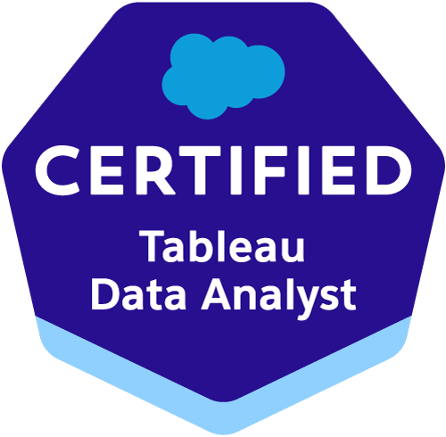

<h2> Hey everyone, my name is Jalil </h2>

# Bio

I'm an alumni of the d.school at Stanford University where I specialized in human-centered design. Prior to joining The Information Lab, I worked as a product manager for a technology startup based in Atlanta, Georgia where I leveraged qualitative research skills (e.g. ethnography, focus groups, etc.) to develop high fidelity prototypes and solutions.

I acquired an interest in data analytics after spending time in the Quantitative Histories Lab, where I used the American Community Survey data to explore social inequality in R. As a data analytics consultant, I use data visualization and communication techniques to inform competitive business strategy. Some of my sample work professional work includes:

- For one client, developing a trend analysis dashboard that automates employee monitoring for their quarterly reporting workflow.
- For another client, I developed a proof-of-concept HR dashboard that streamlines their promotional readiness checks.
- For another, I built a schema that optimizes querying speed for their company wide dashboard.
- I've also built a data pipeline in Snowflake using DDL and DML commands.

Outside of work, I enjoy reading and listening to music.

# Certifications

| Tableau Data Analyst Certification | Alteryx Core Certification |
|:-:|:-:|
| | |

# Projects

**The Superstore business dashboard visualizes the sample superstore dataset from Tableau into a proper business dashboard with a full navigation pane and KPIs!**

  

# Links
[LinkedIn](https://www.linkedin.com/in/jalil-cooper-1b2b0a199/?isSelfProfile=true)
[Tableau Public](https://public.tableau.com/app/profile/jalil.cooper/vizzes)
[Leetcode](https://leetcode.com/u/UQodhpimDo/)

Feel free to contact me with any inquiries here: jalilcooper99@gmail.com !