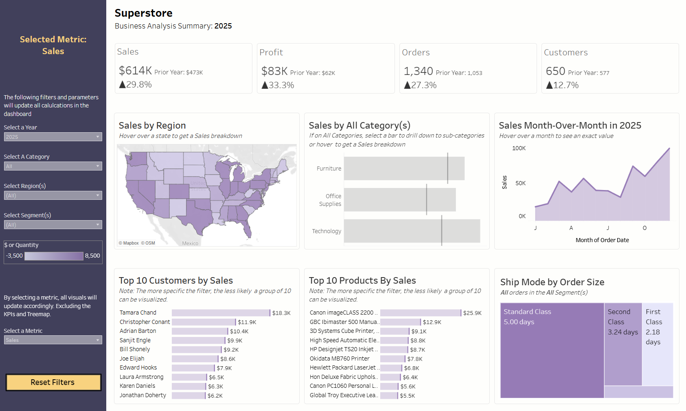
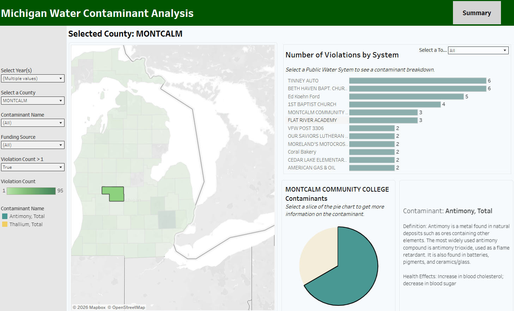

<h1> Hey everyone, my name is Jalil </h1>>

Jalil is an alumni of the d.school at Stanford University where he specialized in human-centered design. Prior to joining The Information Lab, he worked as a product manager for a technology startup based in Atlanta, Georgia where he leveraged qualitative research skills (e.g. ethnography, focus groups, etc.) to develop high fidelity prototypes and solutions. As a designer, he prioritizes accessibility, intuitive user experience and clarity.

He acquired an interest in data analytics after spending time in the Quantitative Histories Lab, where he used the American Community Survey data to explore social inequality in R. As a data analytics consultant, he hopes to use data visualization and communication techniques to inform competitive business strategy.

Outside of work, he enjoys reading and listening to music.

Certifications

Alteryx Core: https://www.credly.com/badges/315bf4f5-5ce4-4596-98df-20d271756c77/public_url

Tableau Data Analyst: https://trailhead.salesforce.com/en/credentials/certification-detail-print/?searchString=wKsUpE/BbuyfMInY/7nNPtxXvfTxSZ+act3y+80ORHlTcLZnzl8oJB2U5oe3Plav

# Projects

** The Superstore business dashboard visualizes the sample superstore dataset from Tableau into a proper business dashboard with a full navigation pane and KPIs!

  

** This dashboard uses the Safe Drinking Water Index from the EPA and analyzes drinking water violations in Michigan

  

